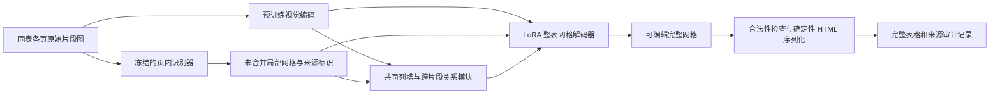

# 跨页表格联合结构重建研究方案与实验决策规范

日期为 2026-11-09，时区 Asia/Shanghai。版本为研究设计 v1。目标为形成具备 CVPR、ICCV、ECCV 等计算机视觉顶会投稿竞争力的研究贡献。会议录用取决于真实贡献与评审，本方案不承诺录用或预设实验成功。

**状态为方案已形成，方法尚未实现、训练或验证。**本文规定后续研发的输入契约、主方法、实验对照、阶段门槛和纠偏方式。所有数值验收门槛均为本次预设的研发决策标准，不是已取得或保证可达到的结果。服务器的实时可用显存、新骨干环境与训练吞吐仍待实际检查。

本文是当前技术路线的统一入口。它细化并修正 [阶段与可行性复核](../reports/2026-11-05-research-stage-and-feasibility.zh-CN.md) 中先前的规则、MLP 与仅关联 Transformer 候选。历史记录保留；规则和仅关联模型进入对照组。以本方案的联合重建假设、验收门槛和证据边界指导后续工作。状态另见 [研究记忆](../research-memory.zh-CN.md) 与 [进度索引](../2026-09-22-research-progress.zh-CN.md)。

## 1. 研究问题、目标与可证伪假设

### 1.1 核心问题

输入已知属于同一张逻辑表的两张或多张页面片段图，及识别器产生的带噪局部表格，恢复完整表格的行列结构、跨格与内容。核心问题是，各页共享的列结构、重复信息及分页边界证据，能否帮助修正单页解析错误，并降低逐对合并造成的错误传播。

第一阶段采用给定同表分组的受控任务，隔离重建器的作用。第二阶段将同一个重建器放回完整文档管线，采用预测的检测框和分组，验证实际效果。给定真值框和同表分组必须明确标作 oracle 条件，不能把受控任务成绩称为完整文档端到端成绩。

主赛道固定为 **image-only**。图像产生的 OCR 或局部 HTML 可以作为输入，PDF 原生文字不进入本赛道。后续若增加 PDF-text-assisted，单独训练、记录和报告，不能把其收益归因于纯视觉重建。

### 1.2 四个研究假设

| 编号 | 待检验假设 | 必须成立的证据 | 推翻或限制假设的现象 |
| --- | --- | --- | --- |
| H1 可修复空间 | 在真实错误中存在足够的结构错误，可以利用同表其他片段及本页可见图像修复 | train 随机审计及保持文本的人工结构修复诊断，发现可重复的列错位、过分割、欠分割或边界错误 | 主要损失来自图像不可辨文字、漏裁内容，结构修复几乎不改变目标指标 |
| H2 联合结构机制 | 具有共同列表示和可编辑网格的模型优于同预算的直接多图生成及仅关联模型 | 相同骨干、数据、图像、训练预算下，主方法取得稳定配对增益，结构模块消融后下降 | 同预算直接 SFT 已达到相同效果，收益仅来自增加参数、训练量或解析容错 |
| H3 多页一致性 | 保留全部原始证据的联合推断降低递归合并的误差积累 | 三页以上自然表中优于前向、反向递归；改善局部结构错误和方向敏感性 | 只在两页或人工拆分样本有效，真实长表不改善或更差 |
| H4 系统价值 | 受控恢复增益能保留到固定上游的完整文档任务 | 同一检测、识别、候选分组下改善跨页结果，且无明显单页退化或误合并增加 | 增益依赖真值裁剪/分组，预测输入时消失 |

H2 是核心方法判断，H3 决定能否主张多页联合推断，H4 决定能否主张文档级系统收益。不能用其中一项成功替代其余证据。

### 1.3 论文预计形成的贡献

目标贡献包括一种可编辑整表表示与跨片段共同结构机制，一套对局部解析噪声及递归误差传播的可复现实验，以及在自然跨页数据上的受控和完整文档验证。图像对结构纠错的作用必须被实验验证。单纯串联识别器、添加规则、换成 Transformer 或增加一个提示词，不自动构成方法贡献。

研究初期采用监督微调与可学习结构模块。强化学习暂不进入主路线。只有监督方案和评价函数均已稳定、且暴露出可量化的训练目标与整表指标不一致时，才另行立项比较 RL 与同预算 SFT；不得以 RL 掩盖数据、标签或评价问题。

## 2. 已有证据、当前差距与相关研究

### 2.1 项目已经完成什么

已提供证据来自 [三模型正式结果](../reports/2026-11-08-dots-paddle-ocrflux-full-val-results.zh-CN.md)、[模型与论文条件汇总](../reports/2026-11-09-tested-models-parameters-inputs-and-results.zh-CN.md) 及其链接的实验记录。本轮沿用保存结果，没有重新推理或评分。

统一整文档条件为 PubTables-v2 Full Documents，revision `aa575e798cb00a296925e2086addb3e3fd9a1903`，validation 935 篇、13,871 页，包括无表页。全表真值 2,587 张，跨页子集 983 张、来自 869 篇文档。

| 已完成条件 | 全表 GriTS-Con | 跨页 GriTS-Con | 跨页内容网格 exact |
| --- | ---: | ---: | ---: |
| dots.ocr 无合并 / 项目简单合并 | 0.5078 / 0.5479 | 0.4577 / 0.5131 | 0 / 2 张 |
| PaddleOCR-VL-1.5 无合并 / 官方原版合并 | 0.6510 / 0.7006 | 0.6727 / 0.7347 | 0 / 6 张 |
| PaddleOCR-VL-1.5 字段兼容版合并 | 0.7744 | 0.8067 | 12 张 |
| OCRFlux 无合并 / 重建合并 | 0.5355 / 0.5963 | 0.5238 / 0.5889 | 0 / 4 张 |

以上 exact 分母均为 983，**未核验来源页完整性，且不能单靠内容网格全等证明所有 span 均正确**。这些数字是现行冻结评分协议下的历史基线。新的给定同表片段实验必须重新建立对应条件的基线，不得拿其结果直接减去上述全文档数值。

TATR-v1.1-Pub 在 Cropped Tables validation 13,384 个样本上的 PDF-text-assisted 复评为 GriTS-Con 0.8704、Acc-Con 38.27%。这是另一输入条件，可用于了解单表能力，不进入 image-only 跨页方法排名。来源见 [TATR 复评](../experiments/2026-09-22-tatr-html-rebuild-rescoring.zh-CN.md)。

**尚未取得的证据**包括 train 真实错误构成、可修复上限、细粒度派生标签可靠性、新方法训练结果、OvisOCR3 和 MinerU-Popo 在本项目统一协议下的结果，以及最终 test 结果。现有低 exact 不足以证明主要瓶颈一定是列对齐或跨页拆分行。

### 2.2 与直接相关工作的关系

下表的公开分数来自各自基准，不能与项目分数直接排名。检索核验日期为 2026-11-09。

| 研究及来源 | 已公开方法或结果 | 对本项目的约束与借鉴 |
| --- | --- | --- |
| [PubTables-v2: A new large-scale dataset for full-page and multi-page table extraction，v4](https://arxiv.org/html/2512.10888v4) | 页对续接 ViT-B/16 的 F1 为 0.991；Full Documents test 中 dots.ocr 的 Con 从 0.5768 升至 0.7495，Acc-Con 均为 11.80% | 续接和整表恢复需分开评估；采用自然多页整表真值，复现同列数纵向拼接对照。页对 F1 不能当作恢复正确率 |
| [MinerU-Popo: Universal Post-Processing Model for Structured Document Parsing](https://arxiv.org/html/2605.24973)；[代码](https://github.com/opendatalab/MinerU-Popo) | 4B 后处理模型处理续接及列边界单元格合并策略；报告 merge method prediction accuracy 92.7% | 必须纳入固定上游的强后处理对照。该准确率衡量合并策略，不能换算为整表 Acc-Con |
| [OCRFlux 官方技术说明和基准](https://github.com/chatdoc-com/OCRFlux)；[OCRFlux-3B 模型](https://huggingface.co/ChatDOC/OCRFlux-3B) | 支持两个 HTML 片段重建；9,064 对人工拆分样本的平均 TEDS 为 0.950 | 复用片段重建接口作对照。人工拆分和真实多页、HTML 输入和图像输入需分列；当前引用为官方说明，不杜撰独立论文标题 |
| [OvisOCR3 Technical Report](https://arxiv.org/html/2610.33066)；[模型](https://huggingface.co/ATH-MaaS/OvisOCR3) | 0.8B 模型输入两页图像与解析结果，生成完整表；多页从后向前递归。CrossTabBench Relation F1 97.07、Reconstruction TEDS 89.66，MPDocBench-Parse truncated-table TEDS 92.04，均为论文 0–100 口径 | 必须比较原始图像保留、合并方向和三页以上重建。不能声称首次进行两图整表恢复。CrossTabBench 数据公开可得性仍待核验 |

POTATR 的 [官方代码](https://github.com/kensho-technologies/POTATR) 与 [POTATR-v1.1-Pub 权重入口](https://huggingface.co/kensho/POTATR-v1.1-Pub) 已有公开来源记录。此前“没有权重所以不能测试”的说法不再作为当前依据；checkpoint 与论文条件、续接分类器的对应关系仍须核对。它进入可复现结构模型对照的候选，不因此延迟核心 train 诊断。

补充新颖性核验清单还包括 [既有小型 VLM 调研](../reports/2026-11-06-small-vlm-cross-page-candidates.zh-CN.md) 记录的 MonkeyOCR v1.5 跨页模块。其论文与公开 checkpoint/API 的对应尚未通过项目级复现核验。进入正式训练和投稿前各做一次一手文献及公开代码复核，补充新出现的直接重建方法；本表不是“已经穷尽所有研究”的声明。

**拟议差异仍是待验证假设。**主方法同时保留各片段原始证据，以共同列结构引导允许拆并和重分配的整表解码。若 OvisOCR3 或同骨干直接多图模型已经实现同样效果，或者结构模块没有独立收益，应降低或撤回相关创新主张。

## 3. 数据协议与监督来源

### 3.1 两层任务与桥接实验

| 协议 | 输入提供什么 | 不提供什么 | 用途 |
| --- | --- | --- | --- |
| R0 真实片段受控恢复 | 原页面的 `parts` 派生裁剪图、真实页序、已知同表分组；冻结识别器在这些图上的预测 | 整表 HTML、真实列数、细粒度对应、PDF 文字 | 主方法开发，隔离恢复问题。GT 辅助裁剪/分组公开声明 |
| R1 预测片段受控恢复 | 固定页级识别器的预测表框/HTML，评估器按固定匹配协议提供同表分组 | 正确局部网格、漏检片段补齐、GT 文字 | 检查真实检测误差。缺片段按失败保留，不只评估全检出的表 |
| D0 完整文档 | 所有页图像、固定检测识别、固定候选分组器的预测结果 | GT 筛页、GT 框、GT 同表分组 | 系统验证，评价漏表、误合并、单页退化及完整恢复 |

R0 的裁剪识别结果与现有完整页面识别结果是不同输入条件。先对同一批 train 片段配对比较，再决定主协议；不能将全页 HTML 复制过来并称为裁剪图推理。R1 中预测到真值的匹配仅用于受控分组与评估，不能泄露到 D0。

D0 首版固定 Paddle 字段兼容版官方合并器产生的候选分组，从未合并表块及 `global_group_id` 等来源记录恢复成员，核验后保存独立 group manifest。只有合并 HTML 而不能恢复成员身份时，先修来源适配，不反推 GT 分组。M、B0/B1、同骨干模型及 Popo 的固定上游对照均消费相同成员列表；各模型原生分组的完整管线另表报告。分组错误与漏检不会被本版重建器自动消除，这是明确的系统边界。

裁剪器保存原图 SHA、原始 `parts`、原坐标与像素变换。边界裁到图内，保留所有片段，页码沿用源数据并记录基准。框坐标的尺度、旋转和含义先用 20 个 train 样本人工核对，未核对前不硬写像素换算。跨页定义为至少两个不同页面；同页跨栏单独统计。非相邻页保持真实页号，不补造片段。[既有清单审计](../experiments/2026-09-29-pubtables-v2-val-cross-page-manifest-audit.zh-CN.md) 已记录一个 `[4,5,7]` 案例。

### 3.2 划分与泄漏控制

官方 train 有 7,359 篇，validation 有 935 篇，test 有 878 篇。既有审计仅证明文档 ID 无交叉，尚不等于内容级无泄漏。

1. 在官方 train 内按文档形成近重复连通分量，再划分 `train_fit / train_dev / train_confirm`，目标比例 70/15/15，固定种子 20261109。所有片段、人工标签、增强样本和合成版本继承原文档划分。同一近重复分量不得拆开。比例因完整分量而略有偏差时报告实际数量，不能根据模型成绩重划。
2. 用训练内图像感知哈希、可用标识符和规范化文本相似度筛查重复；阈值在 train_fit 人工核查后冻结。对于官方跨 split 重复，只生成污染清单，不移动或删除原始数据。正式评分同时报告原始划分和预先确定的去污染分析，明确基座预训练污染仍可能未知。
3. `train_dev` 用于有限选模。`train_confirm` 由冻结配置批量评估一次，打开之后不能再用其结果调参并仍称其为未见确认集。若失败后改方法，登记为第二轮探索，必须重新规划未接触的确认资源，或承认没有独立确认集。
4. 官方 validation 已被多轮观察，将其定位为公开开发基准；不得把在其上发现的提升当作独立确认。官方 test 不用于选模型、提示词、超参数或修复规则。最终所有主方法、强对照和消融配置冻结后，同批进行最终评估。
5. test 的泄漏筛查由独立审计程序输出指纹重合统计，不向研发暴露标签或逐例性能。数据读取范围、规则与结果单独存档。不得为了消除重合而静默改变官方 test 分母。

实际跨页 train 数、各分桶数量及可用确认样本量须重新生成清单，不能用 val 的分布代替。已知 val 的 983 张中两页 801 张、三页以上 182 张，长表统计的置信区间尤其重要。

### 3.3 标签分层与审计

| 层级 | 目标 | 证据与使用方式 |
| --- | --- | --- |
| 官方整表监督 | `tables` 中整表 HTML、`parts` 与原始页面关系 | 可训练整表网格和整表行列数；保留源记录及解析版本。它不自动提供局部 cell 对应 |
| 官方页对标签 | `cross_page_table_pairs` 的页对续接标签 | 只称为页面对续接官方标签；多表页映射到具体表块需要另外派生 |
| 审计过的派生标签 | 局部 cell 到全局列区间、重复表头、边界行、源片段与输出 cell 对应 | 由文本唯一匹配、结构兼容和人工检查产生，记录 `label_source / confidence / ambiguity / reviewer / audit_status` |
| 弱标签 | 启发式可推测但尚未逐项确认的关系 | 仅用于有掩码、低权重的辅助损失；不能作为正式诊断的真值 |
| 不可确定 | 重复空格/数字、歧义空单元格、多种等价编辑、定位不明 | 关系损失不参与计算；保留整表监督，评测分母不因此减少 |

主监督为完整输出网格，避免假定每个样本存在唯一的正确编辑序列。确需关系监督时，优先建立 200 张 train_fit 代表性审计表和至少 100 张双人复核子集；这些是计划数量，实际不足则全量审计并报告。对每类关系分别报告覆盖率与一致性。拟用作高置信监督的关系，抽查正确率需达到 98%，报告 Wilson 95% 区间及样本量，不能凭小样本零错误称为可靠。未达到者继续人工修订或仅作弱标签。

双人复核时先独立标注再裁决，记录裁决前一致性和争议原因；无第二位标注者时该关口标为未通过，Agent 自己复看不能冒充独立双人审计。正式局部修复诊断标签由不看方法输出的审计流程产生。整表 `role` 仅在源 HTML/已核验字段足以判断时监督，其余设为 `unknown` 并掩码；不把猜测的表头角色当作官方标签。

训练集中的图像可见内容和数据集 HTML 也可能存在差异。发现标注错误时保存原标签，建立版本化勘误表；任何修正版评估另表报告，不能只修对本方法不利的样本。

## 4. 主方法的具体实现设计

### 4.1 架构选择与复用边界

主候选采用 **冻结 PaddleOCR-VL-1.5 产生局部证据，Qwen3-VL-2B-Instruct 作为多图视觉语言骨干，新增共同列槽与跨片段关系模块，LoRA 训练整表网格解码器**。官方骨干具备多图输入和微调入口，来源为 [Qwen3-VL 官方代码](https://github.com/QwenLM/Qwen3-VL) 与 [模型卡](https://huggingface.co/Qwen/Qwen3-VL-2B-Instruct)。本项目尚未完成该骨干下载、环境及前缀模块兼容验收。

采用预训练视觉与语言能力，避免从头训练 Table Transformer 或新的 OCR。自研部分集中于共同结构表示、关系学习、可编辑输出和跨页证据实验。Paddle 权重固定，其预测结构允许修改。BGE 加小型 Transformer 的仅关联方案保留为低成本对照，不再承担全部联合纠错主张。



### 4.2 输入表示

每个样本保存 `document_id / group_id / protocol / fragment_ids / page_numbers / image_paths / image_sha256 / upstream_revision / local_predictions`。模型可见部分只含图像、预测局部结构、顺序和匿名片段编号，不含 GT 整表或可用来检索 GT 的语义 ID。训练标签独立文件保存，推理加载器不得访问标签目录。

每个局部单元格节点记录 `fragment_id, local_cell_id, row_start, row_end, col_start, col_end, text`，区间为左闭右开。结构坐标来自预测 HTML，视为带噪观测。表级框来自输入来源；**不设默认 cell bbox**。已有 [Paddle 适配器](../../src/cptla/evaluation/paddle_document.py) 提供表块 HTML 与表级框，不足以证明存在单元格视觉定位。

局部 HTML 解析失败时保存原文和失败类型，模型仍可读图；不能直接用 GT HTML 替换。解析行为按第 7 节冻结。所有原始图像、未合并预测不可变，递归对照的新输出另存，不覆盖其来源。

### 4.3 共同列槽与关系模块

以下为首版工程配置，需要 smoke 后冻结。模块维度 512，4 个注意力块，8 个头。设最多 64 个有序列槽 `s_1...s_64`，顺序表示输出列位置；有效列数 `C` 由分类头预测。GT 列数只用于训练监督，推理不能读取。训练清单若包含超过 64 列的表，在首次训练前扩大槽数并记录配置；评估出现超限时走预先声明的无槽直接解码回退，计入原分母并报告回退率，不能丢弃。

局部节点特征由文本 token 嵌入池化、预测行列/span、片段序号和可用表级位置编码组成。视觉特征采用 Qwen 视觉编码器投影后的 patch 表示，携带对应片段与二维位置。两者线性投影到 512 维。字段来源和归一化方式写入配置，不用 GT 框生成 cell 级特征。

每一块依次执行列槽读取全部片段证据、列槽之间交互、局部节点读取更新后的列槽。所有页在同一层中参与更新。首版保留所有视觉 token，先按第 5 节长度预算验收，不假设压缩后仍保留细字。模块输出以下预测。

- **共同列数及列表示。**从列槽汇聚状态预测 `C`，监督来自整表网格。列槽按顺序固定，不允许用与 GT 的最优置换在推理时重排。
- **局部到全局列区间。**每个局部 cell 预测 `global_col_start / global_col_end / uncertain`；允许覆盖多个列，多个局部 cell 可以指向同一列。对不可确定关系不施加硬监督。
- **边界关系。**对相邻片段的候选表头行和边界数据行预测 `repeat_header / same_logical_row / separate / uncertain`，候选边与掩码保存供消融。首版边界候选为各片段前后 3 行，实际召回先在 train 审计。超出候选仍可由全局解码重建，辅助头的覆盖单列报告。

关系预测先作为软证据供解码器使用，不把单一 argmax 的错误列数或行关系变成不可撤销约束。它们构成可检查的关系图，但“用了图”本身不作为新颖性论据。

首版关系摘要采用固定 16 个 summary token 对局部关系向量做可学习注意力池化，与 64 个列槽合计 80 个结构前缀位置。低置信/未标注关系保留 mask，不能填成“无关系”负例。实际 `C` 小于槽数时以预测概率作软门控，训练时同样使用预测值，避免用 GT 列数 teacher forcing 而造成推理落差。任何调整都进入等长度 memory 消融。

### 4.4 可编辑网格解码与视觉依据

将列槽和关系摘要投影到语言骨干维度，作为固定数量的连续前缀，与全部原始图像 token 和局部网格序列共同进入解码。训练语言骨干 attention 的 LoRA，视觉骨干首版冻结，新增结构模块和投影正常训练。新增前缀不得破坏 Qwen 的视觉位置编码、attention mask 与生成 cache；该接口是阶段 G2 的阻断验收项，不得假定普通文本前缀写法即可正确工作。

输出为整表的规范化 cell 序列，核心字段如下。示例仅说明接口，不是实验结果。

```json
{
  "schema_version": "global-grid-v1",
  "num_rows": 2,
  "num_cols": 2,
  "cells": [
    {"r0": 0, "r1": 1, "c0": 0, "c1": 1, "text": "Item", "role": "header"},
    {"r0": 0, "r1": 1, "c0": 1, "c1": 2, "text": "Value", "role": "header"},
    {"r0": 1, "r1": 2, "c0": 0, "c1": 1, "text": "A", "role": "data"},
    {"r0": 1, "r1": 2, "c0": 1, "c1": 2, "text": "12", "role": "data"}
  ]
}
```

整表节点数量与局部 cell 数量无绑定关系。因此可把一个错误合并的局部 cell 拆为多个输出 cell，把多个局部 cell 合成一个输出 cell，修订行列归属或跨度，并去除重复表头。不是简单重新编号后拼接。文字生成仍可能出错，不能由模型接口断言已具备准确拆分能力。

例如第 1 页把“数量”和“金额”误合并，其他页可提示存在两列，而第 1 页的原图负责区分两个数值实际属于哪列。模型须在对应样例上给出正确网格，并通过遮蔽本页图像、遮蔽其他页结构的配对实验验证证据作用。注意力热图只作辅助展示，不能代替这一验证。

来源采用独立 sidecar 保存 `output_cell_id / source_fragment_ids / source_local_cell_ids / attribution_status`。允许一对多、多对一和 `unresolved`。这份细粒度对应只在有审计标签时监督；无标签时可由可重复的文本匹配推导并明确标为推断，不能称模型准确定位。完整文档输出的 `source_pages` 由实际候选片段组确定并核验，不能凭生成文本任意填入页码。

### 4.5 约束、序列化与错误回退

网格要求坐标为整数、区间有序、跨度不越界、占用位置不重叠，空单元格按冻结的 GT 规范表示。按 `(r0,c0)` 排序生成 HTML，转义文本，使用区间长度写出 `rowspan/colspan`。不要用后处理猜测数字、重排内容或自动丢弃冲突 cell。

约束负责检查合法性。局部拆并、列归属、重复表头与边界行决策由模型学习；合法网格仍可能是错误表格。校验失败保存原始输出，计为失败。主模型指标使用原始方法输出；另报带冻结回退策略的系统指标。首版回退到同条件的直接多图模型或固定基础合并器，回退触发仅依赖输出有效性和预算，不读取 GT，也不在不同候选中用 GT 选最好结果。

### 4.6 学习目标

主损失为整表规范化网格序列的监督交叉熵 `L_grid`，结构坐标、span、内容均有目标。每张逻辑表先按有效目标 token 求均值，再按表平均，避免超长表完全主导训练。前缀、输入图像及预测局部 HTML 不作为生成目标。

辅助项为列数分类 `L_count`、有审计掩码的列区间 `L_col` 和边界关系 `L_boundary`。初始总损失设为 `L_grid + 0.2 L_count + 0.2 L_col + 0.1 L_boundary`，各辅助项按有效标注数归一化，没有对应标签时置零。这些权重为待验证初值，选模仅使用 train_dev。

可选一致性项只在基线和主要模块通过后增加。对同一组图像生成两份带不同局部预测扰动的输入，约束共同列分布及目标结构一致，图片不变；只改变预测噪声，不伪造真实图像内容。首轮不把该项设为必需贡献，防止方法复杂度先于证据增长。

必须检查解码器实际使用共同列槽。将槽替换为同长度无语义 memory、交换其他表的槽、取消辅助监督、或屏蔽其他页证据，分别测量输出变化及准确率。若列头准确但生成结果完全不受影响，不能宣称图结构指导了解码。

## 5. 训练与推理的可执行规格

### 5.1 先处理输出长度与表示

在 train_fit 统计图像 token、局部 HTML token、整表目标 token、行列数、页数的 p50/p90/p95/p99/max。以 Qwen 实际 tokenizer 和 processor 计算，不能用字符数代替 token 数。规范化网格能否比 HTML 更稳定是待检验点，要保留同骨干直接 HTML 与直接网格两个对照。

首轮 smoke 的总上下文预算候选为 32,768 token，图像预算候选为每片段至多 1,024 个视觉 token，目标输出预算候选为 8,192 token；输入、前缀、输出总和不能超过实际模型配置支持范围。先对 train_fit 比较保字清晰度及覆盖，再冻结正式预算。以上是待验收起点，不是模型吞吐或显存承诺。

超预算样本不得静默截断后照常评分。首版明确输出 `context_overflow` 或 `generation_truncated`，保存原始响应，纳入失败分母。若 train 长度统计显示失败风险超过 1%，必须在正式训练前实现分块方案或明确缩小主张，不能等看到 test 再处理。

分块候选为先从全部片段生成共同列表示，然后按源片段/行块生成局部可编辑 cell 序列，最后学习预测边界行关系并组装；每块保留原图和共同结构，不把前块生成结果作为唯一证据。该方案需要局部到全局行对应监督，目前不属于已就绪主实现。只有审计标签足以支持时才增加；否则以完整生成可覆盖的范围为主，同时在全分母报告失败，并停止声称已解决长表。不得把简单截去长样本称为全量能力。

### 5.2 训练阶段

| 阶段 | 数据与训练内容 | 必须留下的证据 |
| --- | --- | --- |
| S0 接口过拟合 | 8–16 张人工核验的 train_fit 小表；先训直接网格，再加入结构前缀 | 损失下降、目标可重建、梯度进入新增模块、保存/恢复一致。该结果只验接口，不报泛化 |
| S1 受控小规模 | 首批最多 500 张 train_fit 自然跨页表；统一冻结上游；主方法与直接 SFT 同数据预算 | train_dev 配对结果、错误与合法率、显存/耗时、各损失有效样本数 |
| S2 扩大真实训练 | 通过 G0–G3 后使用全部可用 train_fit；补充单页样本防止过修复 | 数据规模曲线、固定配置、三随机种子、最优 checkpoint 选择规则 |
| S3 稳健性增强 | 只使用 train_fit 的列拆并、span/重复表头扰动及有限合成分页 | 真实/合成分别采样，真实条件无增强对照，不能用合成成绩替代自然跨页结果 |
| S4 系统接入 | 冻结主方法和检测识别、候选分组；D0 配对评估 | 不读取 GT 的运行证据、完整覆盖、来源与误连报告 |

合成噪声只用于模拟预测错误，图像真实内容保持不变。初始真实/合成训练表采样比例为 4/1，仅在 train_dev 比较 1/0 与 4/1，不能从 validation 错误反推专用增强规则。单页样本单列采样并记录占比，不能通过大量单页训练掩盖自然跨页训练量不足。

### 5.3 初始优化配置与搜索预算

| 配置项 | 初始值或约束 |
| --- | --- |
| 底座与版本 | Qwen3-VL-2B-Instruct，下载前解析 immutable revision，保存权重 SHA；不得长期使用可漂移的 `main` |
| LoRA | `r=16, alpha=32, dropout=0.05`，首版语言 attention 的 q/k/v/o 投影；实际模块名由模型结构核验 |
| 训练范围 | 冻结视觉骨干及底座非 LoRA 参数，训练新增关系模块、投影和 LoRA；打印可训练参数清单 |
| 优化器 | AdamW；LoRA 学习率 `1e-4`，新增模块 `3e-4`，weight decay `0.01`，warmup 比例 `0.05`，梯度裁剪 `1.0` |
| 精度与 batch | 硬件支持时 bf16，microbatch 1，累积到有效 batch 8，gradient checkpointing；不假设共享 GPU 可独占 |
| 训练上限 | 首轮最多 3 epoch，以 train_dev 的结构与内容指标选 checkpoint，保存所有评价记录 |
| 随机种子 | smoke 用 20261109，正式重复使用 20261109/20261110/20261111 |
| 生成 | greedy，固定输出上限，不按 GT 选择候选；允许的重试仅限预定义资源/运输故障，不按分数重试 |

先比较同一组最多 3 个配置，候选只改变 LoRA 学习率 `{5e-5, 1e-4, 2e-4}`，其他参数先固定。需要改变结构维度、图像预算或损失权重时，建立新配置族并记录已花费预算；不能无限搜索后只展示最优种子。每个初筛配置的规划预算上限为 24 GPU 小时，属于成本上限而非完成时间估计。若相同预算不能完成一轮有意义的训练，先缩小 pilot 或统一调整所有学习对照的预算并更新记录。

基线和主模型应共享训练文档、目标、图像分辨率、有效 batch、更新次数和搜索次数。因模块增加而产生的额外参数、token、FLOPs 及实际 GPU 小时单独披露。无法严格对齐计算量时同时给出等训练量结果和成本曲线。

### 5.4 训练时长估算与后台运行

首次估时必须来自本模型真实 smoke，不能沿用 Paddle/OCRFlux 的逐文档加载速度。完成至少 50 个优化 step、覆盖短表与三页以上长表，记录 warmup 后 step 时间、有效 token/秒和峰值显存。估算式为 `总训练 step × 稳态 step 时间 + 验证/保存开销`，分别给出观测中位数与 p90 外推，并说明共享 GPU 变化。

训练前检查 GPU 上已有进程和可用显存；允许使用的 GPU 及环境写入 run manifest。不得终止其他用户进程或假定整卡空闲。数据、模型、缓存和新环境均放服务器项目根目录内，数据及权重不下载到本地。新任务使用带 UTC 时间戳的目录，旧 checkpoint、结果和日志永久保留。

后台托管须验收 SSH 断开后的进程生存、单次恢复及输出去重。恢复检查模型/代码/配置/数据 SHA，不满足一致性时中止恢复并新建实验。OOM、GPU 不足或未知异常保存现场后停止本次任务，不能无限重启或自动降低图像分辨率后混入同一 run。长期任务按项目记录规则更新；本方案编写和同步不启动任何训练、推理或监控。

## 6. 实验矩阵与公平比较

### 6.1 基线优先级

| 编号 | 方法 | 必做条件与作用 |
| --- | --- | --- |
| B0 | 纵向直接拼接、仅去重复表头 | R0 与固定输入 D0，给出简单方法起点 |
| B1 | 保序列对齐与边界规则；学习列对打分但不改局部网格 | 相同输入、来源与解码，判断规则及仅关联已能做到多少 |
| B2 | 每片段独立视觉修复，再用冻结合并器 | 解释增益是否主要来自更强单页识别；须按单页可得监督构造，不能给单页看整表答案 |
| B3 | 同 Qwen 骨干直接多图 HTML / 直接多图网格 SFT | 最重要的学习强对照，同数据、预算、图像及局部预测；分开表示格式收益和结构模块收益 |
| B4 | 同骨干两页递归，前向 / 反向 | 三页以上自然样本，比较保留原图版本和累计生成版本；所有步骤预算计入 |
| B5 | OvisOCR3 官方原生流程 | 核验代码、模型版本、提示和许可后运行。额外以相同片段输入作受控适配版，分别命名，不混称官方协议 |
| B6 | 固定 Paddle 上游 + MinerU-Popo | 补齐原计划的后处理强基线；输入映射先在 train 验收，不能只引用论文分数 |
| B7 | OCRFlux HTML 合并、Paddle 官方/字段兼容版 | 复用已有原始预测，完整文档结果保留；R0 需重新建立同输入基线 |

B0/B1/B3/B4 是开发首批，B5/B6 是正式贡献比较的必要强对照。已有 dots/OCRFlux 全文档结果提供系统背景，但不能代替同骨干 B3。第二上游优先选择已有 dots 预测，测试方法是否只记住 Paddle 错误模式；现有 val 结果可作探索，独立结论需未用于调参的数据。

B2 若没有可靠的局部目标，不得把整表 GT 截成猜测标签来训练。先只比较冻结预训练单页修复，或者在可审计局部目标子集上训练；明确样本范围，并给对应同数据多页版本。

### 6.2 核心消融

主方法 M 为完整可编辑网格、图像、局部预测和共同结构模块。至少包含以下配对。

| 对照 | 保持相同的部分 | 要回答的问题 |
| --- | --- | --- |
| M vs B3 直接网格 | 骨干、目标格式、训练数据、生成预算 | 新结构模块是否超过普通多图微调 |
| M vs 等长度非结构 memory | 可训练参数量尽量匹配，前缀长度/预算相同 | 收益是否仅来自更多 token 或参数 |
| M 去局部结构编辑 | 图像、分组和对应预测，限定只能拼接/重排现有 cell | 拆并、重分配和 span 修复是否必要 |
| M 去视觉 | 保留相同长度的遮蔽/占位 token，保留 HTML | 原图是否用于恢复被错误结构混合的内容 |
| M 去关系辅助损失 | 共同 memory、网格主损失 | 辅助监督是否有效；是否只是无约束额外容量 |
| M 用逐对递归 | 骨干和训练数据；训练/推理预算单列 | 一次共同推断对长表是否有独立价值 |
| M 去合法性约束 | 原始生成器相同 | 改善来自建模还是仅消除了格式错误 |

不能通过将错误结构直接钉死给弱对照、而不给其相同视觉信息，夸大主方法的研究贡献。关系-only 模型用于能力边界诊断；核心性能结论仍须超过强直接生成模型。

### 6.3 跨页证据的必要性验证

整表预测在删除其他页后变差，可能只是少了必须输出的内容，不足以证明“其他页帮助纠正本页”。因此另建 **有审计 cell 来源映射的局部修复诊断集**。

固定目标片段原图及其错误预测，仅更换其他片段上下文为真实同表片段、长度匹配的无关片段、遮蔽片段。只对目标片段对应的受审计单元格结构与内容统计修复/新错，且不能通过 GT 对最终输出作有利筛选。整表指标同步报告但不作该因果解释的唯一证据。对每种上下文保持图像 token 预算，记录分布外替换带来的局限。

另做“输入列表序列化顺序变化但真实页号保留”的一致性检查，它衡量模型是否依赖输入排列捷径；不能与改变真实页面次序混淆。多页增益按 2 页、3 页、4 页及以上分桶，原始各桶样本数和 CI 同时给出。小桶只作探索，不以单个漂亮案例支持稳定提升。

## 7. 评价定义与评分器先决条件

### 7.1 先统一评分协议

现有 [跨页评分实现](../../src/cptla/evaluation/cross_page.py) 在文档内匹配全体真值表，再统计跨页 GT 子集；子集分数不完整惩罚额外预测表。历史严格 XML 解析与作者后续容错 HTML 转换存在实现差异，证据见 [v4 分差核查](../reports/2026-11-09-tested-models-parameters-inputs-and-results.zh-CN.md#2026-11-09-pubtables-v2-v4-对照与分差核查)。

G0 必须固定 GriTS 版本、HTML 解析器、文本规范化、span/空 cell 处理、匹配与聚合公式。先做 train 样本和合成契约案例的逐 cell 比对，再按同一新版对所有待比较的旧预测配对复评。历史分数和产物不覆盖，新增协议与 run ID。不得只把本方法的 HTML 修好而保留其他模型的解析损失，也不得将容错恢复计为模型创新。

最低契约检查包括等价 HTML 得到相同网格、不同 span 不被当作同一拓扑、空 cell 和特殊字符、遗漏行、重复表头、错来源页、额外表、缺表、无表页、截断、非法 HTML、非相邻片段，以及 `grid → HTML → grid` 的语义往返。解析成功也要检查是否吞掉内容。所有评价异常保留日志，失败不能从分母删除。

### 7.2 主指标与附加指标

| 指标 | 统计单位和用途 | 边界 |
| --- | --- | --- |
| GriTS-Top / GriTS-Con | 整张逻辑表，分别衡量拓扑及内容相似度；完整文档沿用冻结官方聚合 | 相似度高不代表完整表正确；宏平均与官方聚合分列 |
| Acc-Top / Acc-Con | 按冻结官方 exact 定义统计，并公布实现；R0 一组输入对应一张整表 | 不能用 HTML 字符串完全相等替代结构/内容网格定义 |
| Joint-Exact | 同一匹配表同时满足拓扑 exact 与内容 exact | 项目新增诊断，不冒称官方 Acc-Con |
| Source-Joint-Exact | Joint-Exact 且预测来源页集合与 GT 相等 | 项目新增诊断；来源页相等也不自动证明每个 cell 来源正确 |
| Continuation P/R/F1、误合并率 | 统一候选页面对和表组，完整管线包含负例 | 只代表关联能力，不能替代重建指标；多表页的块关系为派生标注 |
| 合法率、失败率、回退率 | 全部输入表/文档为分母 | 同时报原始方法和带回退系统，不用回退隐藏失败 |
| 修复与退化计数 | 受审计的列错位、拆并、表头、边界行、span、文字错漏 | 允许多标签，显示各类样本数与未确定类别 |
| 资源指标 | 每整表延迟 p50/p95、峰值显存、输入/输出 token、训练 GPU 小时 | 包括所有递归调用、分块和失败重试；共用上游成本另列 |

R0 的来源页由题目提供，Source-Joint-Exact 不作为新增方法优势。D0 中除跨页子集，必须报告全表指标、单页表指标、未匹配预测数和来源错误；同页不同表不能只靠页集合相等认定同表。若使用 table-part 级来源 exact，须先完成预测块到 GT part 的独立映射审计。

新增 Joint/Source-Joint 首版以规范化拓扑与内容网格的**确定性相等**判断，避免使用接近 1 的浮点阈值偷偷放宽“完全正确”。输出字段明确 `top_exact / con_exact / source_exact / joint_exact`。来源错误不通过重新选择一个有利匹配表掩盖；绑定冻结的文档级匹配。

R0 主表以全部 N 张逻辑表为分母，`Acc-Con = sum(con_exact) / N`，Joint-Exact 同理；缺失、非法、超限或一组生成多张表且违反输出契约均记失败。D0 全表评分按冻结官方聚合，跨页 GT 子集沿用固定匹配但同时报告额外预测。误合并率明确为“预测续接边中错误边数 / 全部预测续接边数”，没有预测边时记为不适用并同时报告召回；不能用零预测的零误连包装成安全有效。官方页对 F1 与派生块级分组误连率分开统计。

### 7.3 统计与报告

全部对照保存逐表结果，再按文档进行配对 bootstrap，固定种子 20261109，2,000 次重采样，95% 区间。存在跨文档近重复时以连通分量为抽样簇。重新采样后重新计算定义的聚合量，而非混用 cell 权重和表均值。三训练种子分别报告，另给均值与方差；数据采样 CI 和训练随机性不混为一个区间。

主要比较预先固定为 M 对 train_dev 上选出的最强预算匹配 B3/B4 对照；确认时不再按 confirm 成绩更换对手。OvisOCR3、Popo 为必须报告的外部强对照，不能因其更好而删除。主指标、门槛和所有候选配置写入实验登记表，其他指标和分桶按次要分析标注，避免事后只挑显著项。

## 8. 分阶段关口、预期结果与暂停条件

以下阈值用于控制研发投入，**均未达成、均非预测结果**。通过某个阈值不等于达到顶会录用标准。证据不足与实际无效分开判断，不能把样本少导致的宽区间解释为方法已失败或已成功。

| 阶段 | 交付物 | 预期与放行标准 | 未达到时的处理 |
| --- | --- | --- | --- |
| G0 数据/评分可信 | train 分组清单、泄漏报告、裁剪审计、评分契约与版本 | missing/extra/duplicate 为 0；所有已知污染有明确处置；20 个坐标样例无未解释错误；网格语义往返与评价契约全部通过 | 先修数据/评价，不扩大 GPU 实验 |
| G1 研究空间成立 | 200 张 train_fit 分层审计、强规则结果、人工结构修复诊断 | 按抽样权重估计至少 15% 的表有可借助跨页证据修复的局部结构问题；保持识别文本的人工结构修复相对强规则 Acc-Top 增加至少 5 个百分点 | 复核误差归因，若主要为文字不可恢复则更换子问题/上游，不靠增大模型证明原假设 |
| G2 技术可训练 | 8–16 表过拟合、至少 50-step 真实 smoke、预测/评分/恢复链 | 新模块梯度非零且被优化器更新；存取和 cache 正确；smoke 全覆盖；小规模确认输出合法率至少 99%，来源日志覆盖 100% | 修接口与表示；两次有记录的修复仍不通过，回退直接 SFT 技术底座并暂停复杂模块 |
| G3 小规模机制信号 | 最多 500 张真实 train_fit，M/B3/B4 对照与证据消融 | train_dev 上有稳定方向的结构改善；局部修复诊断显示相关跨页证据优于长度匹配无关上下文；无明显内容退化 | 排查是否只做单页再识别或额外训练；不打开 confirm 寻找好样例 |
| G4 独立受控确认 | 冻结候选的 train_confirm，三个种子和逐表结果 | 相对最强同预算基线，Acc-Top 提升至少 3 个百分点且配对 CI 下界大于 0；Acc-Con 差值 CI 下界不低于 −1 个百分点；局部结构诊断中的真实跨页上下文贡献至少 1 个百分点 | 有结构收益而内容无收益只保留结构结论；无独立收益不进入大规模扩展，按第 9 节登记新假设 |
| G5 整体恢复与系统价值 | 冻结 R0/R1/D0 的完整结果、来源/误连/退化报告 | 研发目标为 D0 跨页 Acc-Con 提升至少 1 个百分点且配对 CI 下界大于 0；单页 Acc-Con 下降不超过 0.5 个百分点，误合并率增加不超过 0.5 个百分点 | 仅 R0 有效则限定给定片段恢复；不能宣称解决全文档瓶颈 |
| G6 投稿证据闭合 | 最终冻结 test、强对照、消融、泛化、成本与复现材料 | 核心主张在未用于调参的数据上成立；来源与失败可审计；不同上游/外部分布至少一项有独立支持 | 延后投稿或收缩主张，不降低统计标准追赶截稿 |

G1 的人工修复是可利用空间诊断，不是数学上界。抽样采取两页/三页及以上、结构复杂度和预测质量分层，保存总体抽样概率，同时报告加权估计和各层原始计数。不能只挑失败案例计算总体“可提升比例”。

G4 尽量包含至少 300 篇不同文档，三页以上单独报告数量。若可用确认样本不足，则先做精度/区间宽度分析，缩小结论范围；不得临时借 test 扩样或将多个相关片段当作独立样本。G4 是结构机制进入后续验证的必要信号；只有内容整体恢复也有证据，才在标题或摘要中主张提升完整表格恢复。

数值目标允许在观测新实验前经明确论证调整，必须记录旧值、新值、理由和生效的下一批数据。看到当前批结果后降低门槛，只能记为事后探索，不能宣布原验收成功。

## 9. 结果不符合预期时的纠偏矩阵

| 观测现象 | 优先检查的原因 | 最小诊断实验 | 后续决策 |
| --- | --- | --- | --- |
| GriTS 大幅变化但预测相同 | 解析/规范化/匹配版本差异 | 固定预测逐 cell 对比，所有基线同协议复评 | 修评价并重建基线，暂停方法归因 |
| Acc-Top 改善，Acc-Con 不改善 | 内容缺失、错字或文本误分配限制 exact | 在随机审计样本分别做仅结构/仅文字人工修复，不作为正式模型结果 | 增加有图像依据的内容修复或限定结构贡献；不能改成只报 Top |
| 多页模型与单页修复相近 | 增益来自更强识别器或额外训练 | 同骨干、同训练量、同目标片段的局部修复诊断 | 跨页贡献不成立，缩窄任务或改变监督 |
| 替换其他页后局部修复不变 | 模型忽略跨页证据，或诊断样本无需求 | 选取预先审计的跨页必要案例，检查槽敏感性与梯度 | 先修改结构信息通路；再次无效则停止共同结构主张 |
| M 不如直接多图 SFT | 结构瓶颈限制表达、弱标签错误或训练不稳定 | 去关系损失、等参数 memory、可编辑输出不变 | 一次只改一个因素；两轮独立假设仍无收益则采用更简单方法并重新评估投稿价值 |
| 两页有效，三页以上失败 | 长上下文、列模板冲突、生成长度、逐步漂移 | 长度匹配、保持原图的前/后向递归、超长失败统计 | 开发长表方案须另设关口；无改善则删除“多页全局优势”主张 |
| 仅合成样本有效 | 合成错误/分页不符合真实分布 | 真实无增强训练 vs 混合训练，固定自然确认集 | 降低或取消合成增强，改用经审计真实标签 |
| R0 有效、R1/D0 无效 | 漏检、裁剪截断、错分组或未见输入分布 | 只依次替换 oracle 框、分组、识别，做误差瀑布分析 | 判断收益可保留范围；不额外用 GT 修复 D0 输入 |
| 跨页提高但误合并/单页退化 | 太积极地改写或连表 | 难负例、单页保护与训练内阈值校准 | 增加拒绝/不修改训练，重新冻结；不能在 test 选阈值 |
| 只在 Paddle 上有效 | 上游特定格式或错误模式 | 固定第二识别器，零微调迁移和等预算适配分别报告 | 收缩为特定上游，或训练多上游噪声并重新确认 |
| OvisOCR3/Popo 明显更好 | 方法差异不足或复现不公平 | 核对输入条件、训练量、原生/适配协议，再比较同预算方法 | 不能回避最强基线；寻找可证实的效率/泛化贡献，否则停止当前顶会方法路线 |
| 标签一致率不达标 | 局部到整表映射本身歧义 | 双人复核争议类别，记录不可确定比例 | 屏蔽关系损失，保留全网格监督；不硬造唯一标签 |
| 显存/耗时超预算 | token 过长、重复编码、共享资源波动 | train smoke 的分桶 profile；查缓存和加载开销 | 优化实现或统一缩小预算；改变分辨率需所有对照重做相应条件 |
| train 很好、确认集退化 | 过拟合、模板捷径、泄漏、开发数据不代表总体 | 文档/模板簇留出、数据量曲线和污染复核 | 不继续调已打开 confirm；登记失败并规划独立下一轮 |

每次纠偏记录 `原假设 → 证据 → 替代解释 → 单项变更 → 配对实验 → 结论 → 主张变化`。不以“继续加大模型/加 RL”作为默认处理。若关键前提被否定，停止该分支并保留负结果，避免把研究目标偷换成工程演示。

## 10. 分模块实现与验收清单

下列文件均为**计划新增**，当前并不存在；名字是实施契约，不能当作已可运行命令。实际实现先本地分支、最小相关测试、独立复核，再同步服务器小范围验收。

| 工作包 | 拟新增位置 | 输入与输出 | 核心验收 |
| --- | --- | --- | --- |
| P0 协议冻结 | `configs/reconstruction/protocol-v1.yaml` | 数据 revision、赛道、划分、裁剪、解析、指标、预算 | 所有实验读同一配置并记录 SHA；无隐含默认规则 |
| P1 数据构建 | `scripts/build_reconstruction_manifest.py`、`src/cptla/reconstruction/data.py` | Full Documents train → 片段清单、独立 targets、分割/污染/审计清单 | 坐标转换、同页/非相邻页、缺片段、重复 ID、标签隔离 |
| P2 网格表示 | `src/cptla/reconstruction/grid.py` | HTML ↔ 规范化 cell grid；预测来源 sidecar | span、空 cell、特殊字符、重叠/越界、语义 round-trip |
| P3 诊断基线 | `scripts/run_reconstruction_baselines.py` | 冻结局部预测 → B0/B1 输出与错误分层 | 同输入、无 GT 决策、失败保留、来源不丢失 |
| P4 直接 SFT | `scripts/train_reconstruction.py`、`configs/reconstruction/direct-grid.yaml` | 冻结图像/局部预测与整表目标 → LoRA checkpoint | 数据权限隔离、mask、过拟合 smoke、checkpoint 恢复 |
| P5 共同结构模块 | `src/cptla/reconstruction/structure_memory.py`、`model.py` | 多图特征/局部节点 → 列槽/关系前缀 → 完整网格 | shape/mask、非零梯度、优化器更新、位置编码、生成 cache、batch1/2 一致性 |
| P6 可恢复推理 | `scripts/run_reconstruction.py` | 指定 input manifest 与 checkpoint → 原始响应、网格、HTML、sidecar | 原子发布 checkpoint、输入 SHA、无重复、断点恢复、预算失败状态 |
| P7 统一评价 | `scripts/score_reconstruction.py` | 独立读取预测与 GT → 逐表及聚合结果 | 不改变旧评分语义；新增指标分名，匹配与失败覆盖 |
| P8 证据与分析 | `scripts/analyze_reconstruction.py`、`docs/experiments/` | 固定结果 → 配对 CI、错误分桶、案例图、消融表 | 全部候选可追溯，禁止只选成功案例 |

现有可复用入口为 [跨页清单脚本](../../scripts/build_cross_page_manifest.py)、[跨页评分脚本](../../scripts/score_cross_page_predictions.py)、[Paddle 适配器](../../src/cptla/evaluation/paddle_document.py) 和 [案例浏览器](../../scripts/serve_table_case_browser.py)。复用前检查协议是否一致，不直接修改历史冻结运行副本。

新增模块的接口草案为 `build_manifest(config) → input_manifest, target_manifest, audit`、`predict(inputs, checkpoint) → raw, grid, provenance, status`、`score(predictions, targets, protocol) → per_table, aggregate, failures`。训练与评分进程可以读 target；推理进程只收 input manifest，并在小范围验收中证明删除 target 路径仍能运行。

前缀集成必须落实以下实现检查，任一不通过不得扩大训练。

1. 从实际骨干得到投影后的视觉特征和文本 embedding，明确每个 token 的片段来源；禁止将训练 target token 混入共同列模块的输入。
2. 预留固定数量的结构前缀位置，再替换为可微连续 embedding。重新计算 position IDs/mRoPE、attention mask 和 cache position，不能盲目拼接 `inputs_embeds`。
3. 用网格主损失反向传播，验证新增模块梯度、参数变化和 checkpoint 保存加载；只观察辅助列头损失下降不够。
4. 同一样本在逐 token cache 解码和完整前缀计算中应一致到预设数值容差；图像、关系槽不应在每个生成步重复编码。
5. 清除其他页信息或换槽后做审计诊断，确认信息通路确实影响对应局部修复。实现正确和研究有效分开验收。

## 11. 里程碑、预算与最小论文证据

### 11.1 顺序与排期

以下为单人主导、可用共享 GPU 条件下的规划工作量，非已排定完成日期。实际训练等待时间由 smoke 更新，不承诺某次会议截稿前必达。

| 阶段 | 规划工作量 | 依赖和结束产物 |
| --- | --- | --- |
| A 数据与评价审计 | 约 1–2 周 | G0/G1，确认研究空间和标签可获得性 |
| B 小规模直接模型与结构模块 | 约 2–3 周 | G2/G3，先有可用强基线，再验共同结构模块 |
| C 完整训练与受控确认 | 约 2–3 周，GPU 时间另按实测 | G4，三种子、强对照、关键消融 |
| D 完整文档与泛化 | 约 2–3 周 | G5，固定上游、第二上游、来源和负例分析 |
| E 最终冻结与论文组织 | 约 2 周以上 | G6，test 批次、图表、方法和复现资料一致性检查 |

阶段可部分并行，例如数据审计期间核验 OvisOCR3/Popo 的公开接口；依赖关口不可跳过。前期不要同时启动所有模型全量推理。预算优先用于 G1、同骨干直接 SFT 和核心消融，先排除“无空间”和“复杂模块无收益”。

### 11.2 预期结果如何汇报

理想结果是共同结构模块在同预算直接模型之上提升严格整表指标，三页以上增益更明显，审计案例表明其他页帮助修复本页结构，并且完整文档中保留收益。具体可达分数尚无证据，不给出“预计 Acc-Con 达到 90%”一类承诺。

部分成功可能是 Acc-Top 和局部修复提升，但文字错误使 Acc-Con 改善有限；或受控恢复有效但完整文档受漏检/错分组限制。此时必须缩小论文主张并解释余量。没有超过强基线、没有跨页证据贡献或收益来自评分修正，则属于当前方法的负结果，不包装成达到原目标。

### 11.3 最小投稿证据包

1. 一项清晰可证伪、区别于直接两页生成/后处理的机制，及其独立消融。
2. 自然跨页受控恢复与明确输入协议，主表包含最强同骨干模型、OvisOCR3、Popo 和合理简单基线。
3. 完整逻辑表的 Acc-Con、Acc-Top、联合 exact、GriTS 及失败统计，不仅展示页对 F1 或平均相似度。
4. 三页以上自然表、跨页证据局部修复诊断、递归方向与误差传播分析。
5. 若主张全文档能力，提供固定上游 D0、所有页面覆盖、单页退化与误合并检查。
6. 第二上游迁移，及可取得且合法使用的另一自然文档来源。外部数据的获取、标签与污染审计待核验；人工拆分只能作补充。若外部基准不可取得，明确泛化证据不足并评估投稿范围。
7. 三种子、配对统计、计算成本、协议/模型/代码版本，以及可复现的清单和评价脚本。

预计论文主图展示“各页原始证据 → 共同列结构 → 本页错误修复 → 完整表”；主表比较受控与全文档；机制表展示同骨干消融；分析图展示页数/噪声强度/成本曲线。案例按照预注册抽样同时包含成功、失败和新增错误，不只挑最佳案例。

## 12. 记录、变更与同步规则

每个实验建立新的 `docs/experiments/YYYY-MM-DD-任务.zh-CN.md`，由记忆与进度索引链接。服务器根目录固定为 `/data01/public/zhengguojie/paper`，新产物分别放 `artifacts/reconstruction/<RUN_ID>/`、`outputs/reconstruction/<RUN_ID>/`、`logs/reconstruction/<RUN_ID>/`；训练 checkpoint 置于本次 run 的独立子目录，不覆盖模型原权重。数据仍在原始目录只读。

run manifest 必须包含日期/时区、研究问题、状态、数据 revision/split/样本数、输入筛选、模型/权重 revision、赛道、代码 commit 与未提交差异 SHA、环境/依赖、GPU、完整实际命令、随机种子、配置 SHA、输入/输出 SHA、PID/托管方式、日志、完成条件、覆盖/重复/缺失、失败统计、评价版本与主要指标。计划中的值不能伪装成实际运行值。

在完成子阶段、启动/结束/改变后台任务、关键失败、主张变化或准备交接时更新三层记录。旧结论追加勘误，旧产物保留。方法变更登记 `decision_id / date / affected_hypothesis / evidence / previous_config / new_config / data_already_seen / next_gate`，保障后来能解释为何转向。

Git 同步只包含代码、配置和文档，禁止把 `data/`、`models/`、`checkpoints/`、`artifacts/`、`outputs/`、`logs/` 的实验数据上传。服务器现有文件为权威，同步前检查工作区和分支，优先 fast-forward；出现新服务器提交先保留并整合，禁止 reset、强推、删除或覆盖实验目录。本轮只交付方案和既有进度记录，不部署新训练环境。

## 13. 下一次实际执行的起点

下一步只推进 A 阶段的小范围验证。先核对服务器当前 train 数据及既有预测入口，构建文档级划分和真实跨页片段清单；完成 20 个坐标样例、200 张分层审计的首批，以及评分契约对照。产物为数据审计报告、错误构成与可修复空间估计、固定强规则基线。

这批结果回答“联合修复是否值得做、哪些错误最值得做、监督能否可靠构造”。通过后才进入 Qwen 直接 SFT 与结构模块 smoke。若 G1 不成立，在开始大规模微调之前重新讨论研究问题。此处所有步骤均为待执行，不是本轮已经完成的实验。

## 14. 主要来源与阅读入口

- **数据与续接方法** — [PubTables-v2: A new large-scale dataset for full-page and multi-page table extraction，v4](https://arxiv.org/html/2512.10888v4)，2026-11-03 版本；[数据集入口](https://huggingface.co/datasets/kensho/PubTables-v2)。论文版本与本项目固定数据 revision 分开保存。
- **直接两页与多页递归研究** — [OvisOCR3 Technical Report](https://arxiv.org/abs/2610.33066)，2026-10-20；[方法与实验正文](https://arxiv.org/html/2610.33066)。
- **结构后处理研究** — [MinerU-Popo: Universal Post-Processing Model for Structured Document Parsing](https://arxiv.org/abs/2605.24973)；[官方仓库](https://github.com/opendatalab/MinerU-Popo)。
- **HTML 片段重建基线** — [OCRFlux 官方技术说明、数据与基准](https://github.com/chatdoc-com/OCRFlux)；[官方模型卡](https://huggingface.co/ChatDOC/OCRFlux-3B)。当前依据为官方发布文档。
- **视觉语言骨干与微调** — [Qwen3-VL 官方实现与 finetune 入口](https://github.com/QwenLM/Qwen3-VL)；[Qwen3-VL-2B-Instruct 模型卡](https://huggingface.co/Qwen/Qwen3-VL-2B-Instruct)；[PEFT LoRA 官方文档](https://huggingface.co/docs/peft/main/en/task_guides/lora_based_methods)。这些来源支持复用组件，不能证明拟议结构模块已经有效。
- **现有上游识别器** — [PaddleOCR-VL-1.5: Towards a Multi-Task 0.9B VLM for Robust In-the-Wild Document Parsing](https://arxiv.org/abs/2601.21957)；版本与项目运行条件见 [已测模型汇总](../reports/2026-11-09-tested-models-parameters-inputs-and-results.zh-CN.md)。
- **项目已有证据** — [跨页数据清单审计](../experiments/2026-09-29-pubtables-v2-val-cross-page-manifest-audit.zh-CN.md)、[三模型正式结果](../reports/2026-11-08-dots-paddle-ocrflux-full-val-results.zh-CN.md)、[2026-11-09 能力边界纠偏](../reports/2026-11-05-research-stage-and-feasibility.zh-CN.md)、[研究交接](../research-handoff-2026-08-26.zh-CN.md)。

## 15. 本轮文档交付检查点

2026-11-09，本轮只进行了仓库与来源核查、研究设计、文档检查和 Git 同步准备。未创建新实验结果，未启动 GPU/CPU 评分、训练或后台监控。写作基于本地 commit `2fd0cef`；同步前 GitHub 和服务器当前分支均为 `codex/paddle-merge-compat` 的 `006da59`，服务器工作区干净。

本轮将此前尚未提交的 Paddle/OCRFlux 正式评分记录、结果汇总与近期研究判断一起归档，补齐方案的本地证据链接。已检查 Markdown 相对文件链接、章节锚点、代码块闭合与 diff 空白错误；实验设计审查重点检查了确认集泄漏、强基线、结构/内容归因和数值门槛。架构接口仍需 G2 实验验收，不把文档审查当作模型验证。

计划发布到当前 `codex/paddle-merge-compat` 分支并快进服务器同名工作分支；本轮不改变 `main`。实际同步完成以 Git 提交与两端 HEAD 核验为准，后续同步证据写入进度索引。服务器原始数据和历史产物不参与此次 Git 更新。

同步补记。主体提交 `cbb56b942768bf55dc363046343816cb91d8524d` 已在本地、GitHub 和服务器当前分支核验一致，工作区干净；该版方案 Git blob 为 `d7a02ccb8070848ee45b494b6c0e6df0f2f6209e`。此次另追加交付留痕，最终记录提交见 Git 历史。同步检查不等于实验完成，下一步仍为第 13 节的 train 小范围审计。
